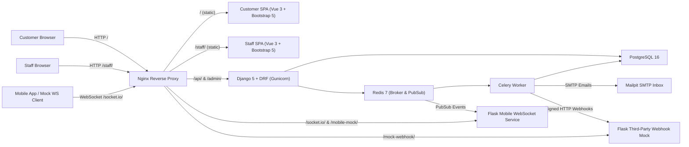

# DjangoAir ERP System — Architecture & Module Decomposition

## 1. Architectural Overview

**DjangoAir** is an Airline Management ERP system uniting passenger-facing ticket booking, emulated payment processing, personal cabinet self-service, role-governed airport staff operations, asynchronous notifications, a real-time mobile WebSocket API, and third-party partner webhook integrations.

## 2. Service & Module Decomposition

### Django Core ERP (`backend/apps/`)

| App | Responsibility | Key Entities |
| :--- | :--- | :--- |
| **`accounts`** | Custom email-based authentication, JWT tokens, customer profiles/balance, and strict ordered Staff Role Hierarchy (`Gate Manager` < `Check-in Manager` < `Supervisor`). | `User`, `CustomerProfile` |
| **`fleet`** | Airline physical assets and cabin capacity configurations. | `Airport`, `Airplane`, `SeatType`, `AirplaneSeatConfig` |
| **`flights`** | Flight schedules, selectable extra options (meals, luggage, comfort), seat availability calculation, Supervisor flight creation/cancellation, and demo seeding. | `Flight`, `Option` |
| **`bookings`** | Transactional seat reservation (`select_for_update`), passenger records, tickets (`ticket_code`), discount codes, pricing engine, Personal Cabinet online check-in, counter check-in + luggage fee, and gate boarding. | `Booking`, `Passenger`, `Ticket`, `TicketOption`, `Discount` |
| **`payments`** | Pluggable emulated payment gateway (`EmulatedGatewayProvider`), transaction audit records, invoice numbers, balance top-ups, and automatic refund-to-balance on Supervisor flight cancellation. | `Payment` |
| **`notifications`** | Asynchronous Celery email workers delivering tickets, itemized bills/invoices, auto-generated Personal Cabinet credentials, and cancellation notices. | `EmailLog` |
| **`integrations`** | Publishes real-time domain events to Redis Pub/Sub (`djangoair:events`) and dispatches HMAC-SHA256 signed HTTP webhooks via Celery with delivery logs. | `WebhookSubscription`, `WebhookDelivery` |

### Flask Mock Microservices (`services/`)

1. **`services/mobile_ws` (Flask + Flask-SocketIO)**
   - Subscribes to the Redis Pub/Sub channel `djangoair:events` on a background greenlet.
   - Allows mobile clients to connect via WebSocket (`/socket.io/`) and subscribe to specific flight rooms (`flight:<flight_number>`) or ticket rooms (`ticket:<ticket_code>`).
   - Provides a live mock mobile dashboard at `/mobile-mock/` for visual verification.
2. **`services/webhook_mock` (Flask)**
   - Emulates a third-party airline partner / analytics / accounting system.
   - Receives `POST /mock-webhook/events`, verifies the `X-DjangoAir-Signature` HMAC-SHA256 header against a shared secret, rejects tampered payloads with HTTP `401`, and exposes an inspection JSON feed & UI at `/mock-webhook/`.

### Independent Web Interfaces (`frontend/`)

Webpack 5 compiles two completely independent Vue 3 + Bootstrap 5 single-page applications:
- **Customer Interface (`/`)**: 3-input welcome search (Destination, Date, Passengers) -> Flight/Seats/Options & Discount selection -> Emulated Payment checkout -> Confirmation & emailed Personal Cabinet credentials -> Personal Cabinet (future/past flights, balance, online check-in).
- **Staff Interface (`/staff/`)**: Role-gated operations portal enforcing the ascending staff hierarchy:
  - **Gate Manager (L1)**: Board checked-in passengers by `ticket_code`.
  - **Check-in Manager (L2)**: Check in passengers, add options, collect luggage fees (+ Gate Manager actions).
  - **Supervisor (L3)**: Add/remove Gate & Check-in Managers, create/cancel flights, add/remove options (+ Check-in & Gate Manager actions).

## 3. Role Hierarchy & Access Matrix

| Capability | Customer | Gate Manager (L1) | Check-in Manager (L2) | Supervisor (L3) |
| :--- | :---: | :---: | :---: | :---: |
| Search flights, book & pay | Yes | — | — | — |
| Personal Cabinet & Online Check-in | Yes | — | — | — |
| Board passenger at gate (`ticket_code`) | — | Yes | Yes | Yes |
| Counter check-in, add options & luggage fee | — | — | Yes | Yes |
| Create / cancel flights | — | — | — | Yes |
| Add / remove flight options | — | — | — | Yes |
| Add / remove Gate & Check-in Managers | — | — | — | Yes |
| Manage Webhook subscriptions | — | — | — | Yes |
