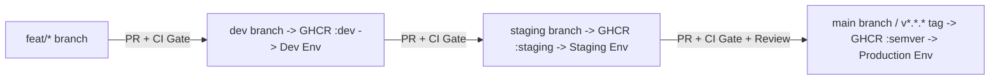

# Enterprise Multi-Environment Architecture & Branch Promotion

DjangoAir isolates runtime behavior, secrets, container images, and deployment safety across **four dedicated environments**: `test`, `dev`, `staging`, and `prod` (`main`).

## 1. Branch Promotion & Release Pipeline



## 2. Environment Matrix

| Attribute | `test` | `dev` | `staging` | `prod` (`main`) |
| :--- | :--- | :--- | :--- | :--- |
| **Django Settings** | `config.settings.test` | `config.settings.dev` | `config.settings.staging` | `config.settings.prod` |
| **Compose Override** | `docker-compose.test.yml` | `docker-compose.dev.yml` | `docker-compose.staging.yml` | `docker-compose.prod.yml` |
| **Env Template** | `.env.test.example` | `.env.dev.example` | `.env.staging.example` | `.env.prod.example` |
| **`DEBUG`** | `False` | `True` | `False` | `False` |
| **Cache Backend** | `LocMemCache` | `LocMemCache` | `RedisCache` | `RedisCache` |
| **Database Storage** | Ephemeral `tmpfs` | Named Docker volume | Persistent volume / Managed DB | Managed PostgreSQL + Backups |
| **Email Backend** | In-memory (`locmem`) | Mailpit SMTP (`:8025`) | Staging SMTP Relay | Production Transactional SMTP |
| **Demo Data Seeding** | In test fixtures | Automatic on startup | Automatic on startup | **Disabled** (`APP_ENV=prod`) |
| **Container Images** | Local build | Local build + bind mounts | `ghcr.io/.../<svc>:staging` | Immutable `ghcr.io/.../<svc>:vX.Y.Z` |
| **Security Headers** | Relaxed | Relaxed | HSTS (1h), Secure Cookies, Proxy SSL | HSTS Preload (1y), Strict Hosts/CORS |
| **Health Probes** | `/api/v1/health/{live,ready}/` | `/api/v1/health/{live,ready}/` | `/api/v1/health/{live,ready}/` | `/api/v1/health/{live,ready}/` |

## 3. Running Each Environment Locally

```bash
# Development (bind-mounted live reload, Mailpit :8025, exposed Postgres/Redis)
make up-dev

# Isolated Test Suite (ephemeral tmpfs PostgreSQL + Redis + coverage)
make test-env

# Staging Preview (production-like settings + resource limits)
cp .env.staging.example .env.staging
ENV_FILE=.env.staging docker compose -f docker-compose.yml -f docker-compose.staging.yml up -d

# Production (pinned immutable GHCR release tag)
cp .env.prod.example .env.prod
ENV_FILE=.env.prod IMAGE_TAG=v1.0.0 docker compose -f docker-compose.yml -f docker-compose.prod.yml pull
ENV_FILE=.env.prod IMAGE_TAG=v1.0.0 docker compose -f docker-compose.yml -f docker-compose.prod.yml up -d

# Validate all 5 Compose configurations at once
make validate-envs
```

## 4. Recommended GitHub Repository Settings (Enterprise Governance)

1. **Create Long-Lived Branches**: Create `dev` and `staging` from `main` to enable multi-stage promotion (`feat/*` -> `dev` -> `staging` -> `main`).
2. **Branch Protection Rules**:
   - **`main`**: Require Pull Request + 1 approving review + all CI status checks (`Backend Lint, Security & Pytest`, `Flask Mobile WS & Webhook Mock Tests`, `Frontend Webpack Production Build`, `Multi-Environment Docker Compose Validation`). Disallow force-pushes.
   - **`staging` & `dev`**: Require CI status checks to pass before merging.
3. **GitHub Environments** (`Settings -> Environments`):
   - `dev`: Auto-deploys on push to `dev`. Optional secret: `DEV_DEPLOY_WEBHOOK_URL`, variable `DEV_APP_URL`.
   - `staging`: Auto-deploys on push to `staging`. Optional secret: `STAGING_DEPLOY_WEBHOOK_URL`, variable `STAGING_APP_URL`.
   - `production`: Enable **Required Reviewers** (manual approval gate before prod rollout) and restrict deployment branches to `main` and `v*.*.*` tags. Optional secret: `PROD_DEPLOY_WEBHOOK_URL`, variable `PROD_APP_URL`.
